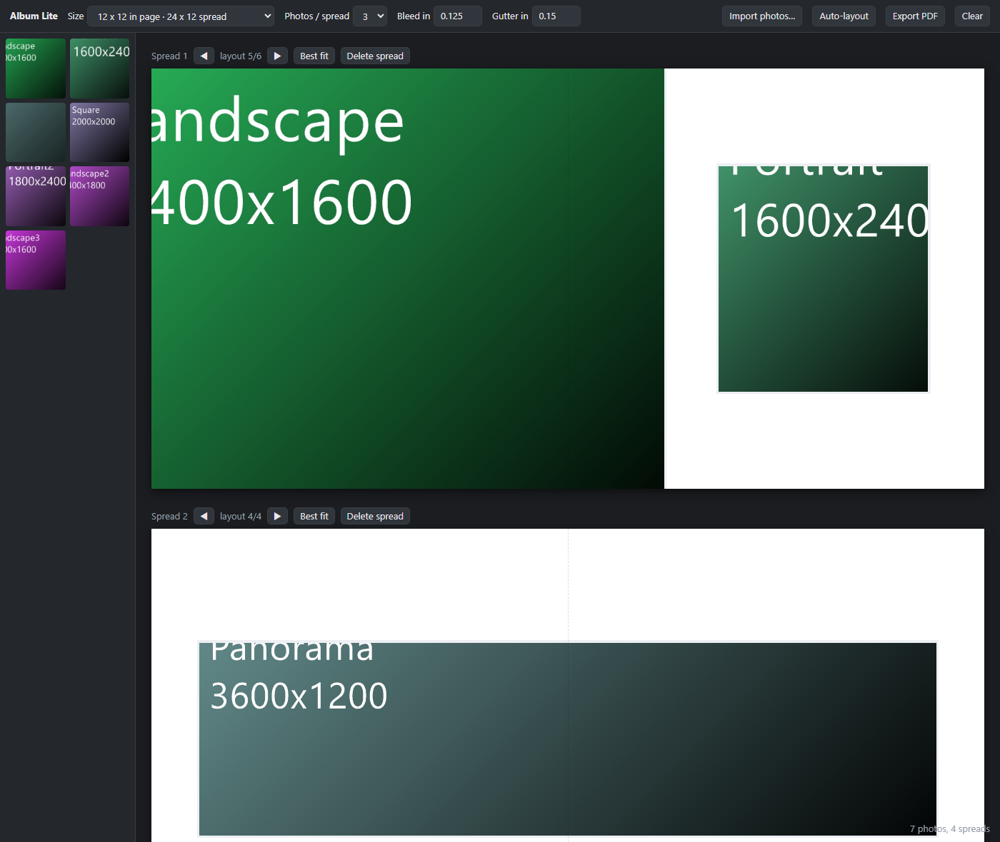

# Album Lite

A small photo album designer: import photos, get spreads laid out automatically,
tweak them, export a print-ready PDF.



## Quick start — no installation

Download the repo (**Code → Download ZIP**, or `git clone`), unzip, and **double-click
`album.html`**. That's it. It's a plain page running from `file://` — no Node, no npm,
no server, no build. Works in Chrome or Edge.

Export uses the browser's own print dialog: **Export PDF → Destination "Save as PDF"**.
Check the preview page size matches the number in the status bar (e.g. `24.25 x 12.25 in`);
if it doesn't, set it under **More settings → Paper size**, and leave Margins at Default/None.

### Optional: run it as a desktop app

The same page also runs in an Electron shell, which adds a proper save dialog and real
file paths (so a saved album reopens without re-importing).

```powershell
npm install
npm start
```

> **If `npm install` fails**, you're probably on a machine pointed at a private registry.
> `npm config get registry` should be `https://registry.npmjs.org/`. Fix it for this
> project only with `npm config set registry https://registry.npmjs.org/ --location project`,
> or authenticate to your corporate feed. This is the only step that needs the network —
> everything else works offline. The browser version needs none of it.

## What it does

- **Import** — button, or drag files onto the window. Importing the same file twice
  reuses it rather than duplicating.
- **Auto-layout** — photos are chunked into spreads (panoramas get their own), then each
  spread picks the template whose slot shapes best match the photos landing in them.
  Photos fill slots in reading order, so chronology survives.
- **Tweak** — drag a thumbnail onto a slot to replace it, drag the `⠿` handle to swap two
  slots, drag inside a photo to re-frame the crop, double-click to recentre, `◀ ▶` to cycle
  layouts, `Best fit` to re-pick. Importing more photos appends new spreads and leaves your
  existing arrangement alone; `Auto-layout` is the one that starts over.
- **Export** — one PDF, one page per spread, sized `spread + bleed`. Source JPEGs embed
  losslessly at full resolution, so a 24 MP photo in a 12×8 in slot prints at ~500 DPI.

### Saving

Your arrangement autosaves to the browser's local storage and reloads on next launch.
In the desktop app photos come straight back. In the browser they can't — a page can't keep
file handles across a reload — so slots show the file name and you re-import the same files
to fill them in (any order; matching is by name and size, not order). Don't move or rename
the originals.

## How it works

The whole thing is the DOM. Spreads are absolutely-positioned `<div>`s sized in inches;
export is `window.print()` against a generated `@page` rule, with print CSS hiding the UI.
No canvas, no compositing, no image library, no dependencies.

| File | |
|---|---|
| `album.html` | Markup. Double-click this. |
| `layout.js` | Page sizes, slot templates, and the fit heuristic. Pure functions, no DOM. |
| `app.js` | State, rendering, drag interactions, import/export. |
| `style.css` | Screen styles plus the `@media print` rules that make export work. |
| `main.js`, `preload.js` | Optional Electron shell. Absent when running from `file://`. |
| `test.js` | Checks for `layout.js`. |

`app.js` detects the shell with `const IS_APP = !!window.api` and branches in exactly two
places — file paths and export. Everything else is one code path.

## Continuing this project

```powershell
node --test        # or: npm test
```

Seven checks, no framework, nothing to install. `layout.js` is the only file with real
logic, so it's the only file with tests — they caught two genuine bugs (a missing
landscape-leaning 5-up template, and a 6-up set with no portrait option). Keep that bar: if
you add templates, the existing no-overlap and "portrait sets choose narrower slots than
landscape sets" checks will police them for free.

**Adding a page size** — one row in `PAGE_SIZES`. **Adding a layout** — one array of
`r(x, y, w, h)` rects in `TEMPLATES[n]`, coordinates as fractions of the *spread* (two
facing pages), listed in reading order. Both are picked up automatically.

**Verifying export** without clicking through a dialog — headless Chromium prints the same
way the dialog does:

```powershell
& "C:\Program Files (x86)\Microsoft\Edge\Application\msedge.exe" --headless=new `
  --disable-gpu --no-pdf-header-footer --virtual-time-budget=20000 `
  --print-to-pdf=out.pdf "file:///C:/path/to/album.html"
```

Then check the result really is print-ready — page count, exact page size in inches, and
that photos went in as untouched JPEG streams rather than re-encoded bitmaps:

```powershell
node -e "const b=require('fs').readFileSync('out.pdf').toString('latin1');const m=[...b.matchAll(/MediaBox\s*\[\s*([-\d.]+)\s+([-\d.]+)\s+([-\d.]+)\s+([-\d.]+)/g)].map(x=>[(+x[3]-+x[1])/72,(+x[4]-+x[2])/72]);console.log(m.length,'pages',JSON.stringify([...new Set(m.map(String))]),(b.match(/DCTDecode/g)||[]).length,'jpegs')"
```

Last run: **4 pages, all `24.25 x 12.25` in, 7 jpegs** for 7 photos at 12×12 with 0.125 in bleed.

## Settings

| Setting | Default | Notes |
|---|---|---|
| Size | 12 × 12 in page | Spread is two pages wide |
| Photos / spread | 4 | 1–6 |
| Bleed | 0.125 in | Edge photos extend into it; most labs require this |
| Gutter | 0.15 in | Space between photos |

## Deliberately not built

Cover and spine design, text and captions, per-photo zoom, colour correction, crop marks,
face detection, cloud sync, undo history, `.album` project files, installers. Add whichever
one you actually miss after using it.
